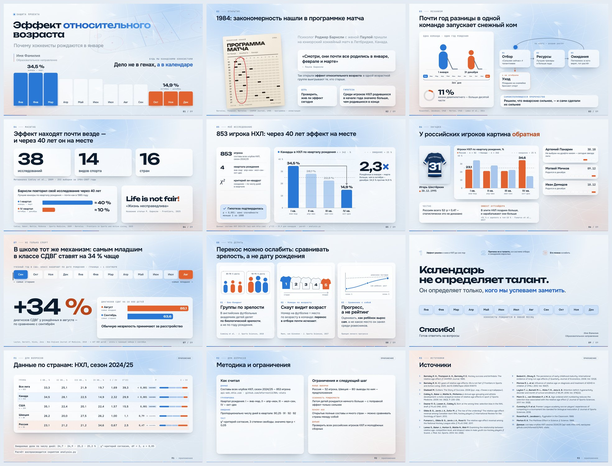
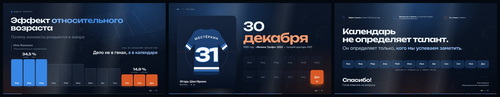

# Эффект относительного возраста — лекция для марафона лекториев «Поток»

**Почему хоккеисты рождаются в январе.** Презентация на 12 слайдов: 10 основных + 2 резервных для вопросов жюри.

## Файлы

| Файл | Для чего |
|---|---|
| [`presentation.pptx`](presentation.pptx) | **Основной файл для конкурса** — Microsoft PowerPoint, светлая тема (для проектора в освещённом зале) |
| [`presentation-dark.pptx`](presentation-dark.pptx) | Та же презентация в тёмной теме — для затемнённого зала или большого экрана |
| [`presentation-simple.pptx`](presentation-simple.pptx) | Простая версия: белый фон, Calibri, стандартные фигуры и диаграммы PowerPoint, только эффект «Выцветание» |
| [`presentation.html`](presentation.html) | Интерактивная веб-версия (резерв: работает в любом браузере без интернета) |

## Соответствие Положению конкурса

- **Формат — Microsoft PowerPoint** (.pptx) ✔
- **Не более 12 слайдов** — ровно 12 ✔
- **Титульный слайд с Ф.И. и образовательным направлением** — поля на слайде 1, *впишите свои данные* ✔
- **Доклад не более 5 минут** — текст рассчитан на ≈ 4:40 вместе с двумя интерактивами; хронометраж по слайдам — в заметках ✔
- **Интерактив и вовлечение аудитории** — «поднимите руку» (слайд 1) и загадка про Шестёркина (слайд 6) ✔
- **Готовность к вопросам** — в заметках к слайдам 11–12 ответы на 6 вероятных вопросов жюри и методика ✔

## Перед подачей — 3 минуты

1. Откройте `presentation.pptx`, на слайде 1 щёлкните по «Имя Фамилия» и «Образовательное направление» и впишите свои данные.
2. *(По желанию)* Фото Шестёркина: правый клик по картинке с джерси на слайдах 6 и 7 → **«Изменить рисунок»**.
3. Сохраните и проверьте показ: **F5** — с начала, **Alt+F5** — режим докладчика (текст доклада и таймер видны только вам).
4. Шрифты стандартные для Windows и Office (Arial, Arial Black, Consolas, Cambria) — на компьютере площадки ничего устанавливать не нужно.

## Как устроен показ

- **Каждый щелчок — следующая фраза доклада.** Анимации появляются ровно под текст; в заметках пометки «[КЛИК 1]», «[КЛИК 2]»… Всего 25 щелчков.
- Между слайдами 6 и 7 — переход **«Трансформация»**: фото уменьшается, появляются данные (PowerPoint 2019, 2021, 365; в более старых версиях — плавное затухание).
- Графики — **настоящие диаграммы PowerPoint**: данные можно открыть и проверить (правый клик → «Изменить данные»).
- Весь текст доклада — в **заметках** к каждому слайду.

## Веб-версия (presentation.html)




---

### Подготовка веб-версии

1. Откройте `presentation.html`, нажмите **E** и впишите на слайде 1 своё **имя и фамилию** и **образовательное направление** (они продублируются на последнем слайде).
2. *(Необязательно)* Перетащите фото Шестёркина на рамку слайда 6 «Загадка». Без фото там стоит стилизованное джерси «ШЕСТЁРКИН 31».
3. Нажмите **Ctrl+S** — сохранится новый файл, где имя и фото уже внутри. На защиту несите **его**.
4. Подстраховка: **Ctrl+P → «Сохранить как PDF»** даст PDF-копию всех слайдов. Возьмите её на флешке вместе с HTML.
5. На компьютере в аудитории: откройте файл, нажмите **F**, пролистайте пару слайдов. Если компьютер слабый и анимации дёргаются — **M** (облегчённый режим).

### Управление веб-версией

| Клавиша | Действие |
|---|---|
| **→**, пробел, клик, пульт-кликер | следующий шаг (одна фраза доклада = один клик) |
| **←** | назад |
| **F** | во весь экран |
| **S** | окно докладчика: текст доклада по шагам, таймер, темп «по плану / отстаёте», шпаргалка ответов комиссии |
| **N** | текст доклада внизу экрана (для репетиции) |
| **T** | светлая / тёмная тема |
| **B** или **.** | чёрный экран (пауза, внимание на докладчика) |
| **O** | все слайды сеткой |
| **6** + Enter | перейти к слайду 6 (10–12 — приложения) |
| **Home / End** | к началу / к выводам |
| **E**, **Ctrl+S** | правка имени и фото / сохранить файл |
| **M** | облегчённый режим для слабого ПК |
| **H** | справка |

Клавиши работают и в русской раскладке. На слайде 6 можно кликать по месяцам, которые называет зал, — отметки не листают слайд.

---

## Почему так: решения на основе исследований

| Решение | Основание |
|---|---|
| **Заголовок слайда — готовый вывод** («853 игрока НХЛ: через 40 лет эффект на месте»), под ним — визуальное доказательство, а не список пунктов | Подход assertion–evidence: лучше понимание и запоминание через неделю, ниже когнитивная нагрузка — [Garner & Alley, 2013](https://www.ijee.ie/articles/Vol29-6/23_ijee2791ns.pdf); [обзор исследований Penn State](https://writing.engr.psu.edu/research.html) |
| **Минимум текста на экране**, полный текст — в окне докладчика | Принцип избыточности и когерентности Майера (медианный эффект d ≈ 0,86): лишний текст и декор мешают слушать — [Mayer, Cambridge Handbook](https://resolve-he.cambridge.org/core/books/cambridge-handbook-of-multimedia-learning/principles-for-reducing-extraneous-processing-in-multimedia-learning-coherence-signaling-redundancy-spatial-contiguity-and-temporal-contiguity-principles/CD5B7AE1279A9AB81F8EEBB53DBEC86E) |
| **Без декоративных стоковых фото**: каток, джерси, программка 1984 — смысловая графика | «Соблазнительные детали» снижают усвоение (g ≈ −0,33) — [Sundararajan & Adesope, 2020](https://inspire.acu.edu.au/articles/seductive-details) |
| **Пошаговое появление** под каждую фразу доклада | Принципы сегментации и временной смежности Майера |
| **Светлая тема по умолчанию**, тёмная — одной клавишей | Тёмный текст на светлом фоне читается лучше и на экране, и на проекторе — [Stucchi & Zavagno, 2008](https://www.pubmed.gov/19110842/) |
| **Синий = «ранние» (январь–март), оранжевый = «поздние»** — единый код через все слайды | Пара синий/оранжевый различима при всех типах дальтонизма (палитра [Okabe & Ito](https://siegal.bio.nyu.edu/color-palette/)); проверено валидатором: ΔE ≥ 24, контраст ≥ 3:1 |
| **Серый фон + один акцент** на графиках, подписи прямо у столбиков, без легенд где можно | [Storytelling with Data, Knaflic](https://shrm.org/topics-tools/news/technology/using-pictures-storytelling-to-present-business-data); предвнимательные признаки |
| **«Лента месяцев» — сквозной мотив**: поднятые руки → гистограмма → программка → школьный год с сентября → финал, где все 12 месяцев равны | Повторяемый визуальный якорь снижает нагрузку и связывает историю в одно целое |
| **Интерактив в начале и загадка в середине** («В каком месяце родился Шестёркин?») | Информационный разрыв (Loewenstein, 1994) и любопытство улучшают запоминание — [Gruber et al., 2014](https://shohamylab.zuckermaninstitute.columbia.edu/sites/default/files/2017-02/Curiosity.pdf); «момент, который запомнят» — [Duarte, STAR moment](https://www.duarte.com/blog/secret-to-unforgettable-events-and-memorable-speeches/) |
| **Сильный финал** — одна фраза крупно и 12 одинаково светящихся месяцев | Правило «пик-конец» и эффект края: помнят пик и окончание — [Kahneman et al., 1993](https://en.wikipedia.org/wiki/Peak%E2%80%93end_rule) |
| **Анимации 220–950 мс**, плавные кривые «ease-out»; учитывается «уменьшить движение» в ОС | Рекомендации по длительности интерфейсной анимации (≈100 мс — мгновенно, до 500 мс — для переходов) — [обзор](https://valhead.com/?p=2978) |
| **Шрифты:** Unbounded (заголовки и числа), Onest (текст), JetBrains Mono (данные) | Современные гарнитуры с полноценной кириллицей; крупный кегль для проекции (заголовки 60 px, текст ≥ 26 px на холсте 1920) |
| **Фон «лёд»** с процедурными следами коньков, светлый тон близок к Pantone 2026 Cloud Dancer | Тренд 2026 — спокойный белый, «стеклянная» глубина, крупная типографика и бенто-сетки — [Pantone 2026](https://www.trendhunter.com/trends/pantone-114201-cloud-dancer), [тренды](https://slidesgo.com/slidesgo-school/ai-presentations/presentation-design-trends-2026) |

## Проверка фактов

Все цифры из текста защиты сверены с источниками:

- 38 исследований / 14 видов спорта / 16 стран — [Cobley et al., 2009](https://www.doi.org/10.2165/00007256-200939030-00005).
- ≈ 40 % лучших юниоров в I квартале и ≈ 10 % в IV; статья «Life is not fair!» — [Barnsley, Frontiers, 2025](https://www.frontiersin.org/journals/sports-and-active-living/articles/10.3389/fspor.2024.1516173/pdf).
- СДВГ: 85,1 против 63,6 на 10 000 детей (+34 %) — [Layton et al., NEJM 2018, сводка NIH](https://commonfund.nih.gov/earlyindependence/highlights/adhd-or-adolescence).
- Номера по возрасту убирают перекос у скаутов — [Mann & van Ginneken, 2017](https://pubmed.ncbi.nlm.nih.gov/27238077/).
- Элита НХЛ, рождённая в IV квартале, зарабатывает на 51 % больше — [Fumarco et al., 2017](https://scholarsarchive.byu.edu/facpub/2859).
- Даты рождения: Шестёркин 30.12.1995, Панарин 30.10.1991 (не задрафтован), Мичков 09.12.2004, Демидов 10.12.2005.
- χ² пересчитан по таблице автора (ожидание — по числу дней в квартале): Канада χ²(3) = 29,9, p < 0,001; США 15,5 (p = 0,001); Швеция 1,1 (p = 0,79); Россия 2,5 (p = 0,47); вся лига 39,3 (p < 0,001).

## Устройство

```
presentation.pptx        ← PowerPoint (собирается из pptx/)
presentation-dark.pptx   ← PowerPoint, тёмная тема
pptx/build_assets.js     ← рендер графики для PowerPoint из веб-версии (Playwright)
pptx/build_deck.js       ← сборка слайдов: тема, макеты, разделы, диаграммы, заметки (pptxgenjs)
pptx/postprocess.py      ← анимации по щелчку, переходы, подписи диаграмм
presentation.html        ← веб-версия (собирается из src/)
src/slides.html          ← разметка слайдов и текст докладчика (<aside class="notes">)
src/styles.css           ← дизайн-система: токены двух тем, «ледяное стекло», слайды, печать
src/engine.js            ← навигация, шаги, окно докладчика, обзор, фото, сохранение, PDF
src/shell.html           ← каркас страницы, справка, шпаргалка ответов комиссии
src/build.py             ← сборка: графики по данным, каток по разметке НХЛ, типографика, шрифты
src/fonts/               ← Unbounded, Onest, JetBrains Mono (OFL), только нужные подмножества
```

Пересобрать веб-версию: `python3 src/build.py`.
Пересобрать PowerPoint: `cd pptx && npm install && node build_assets.js && node build_deck.js light && python3 postprocess.py light` (для тёмной — `dark`).

Шрифты распространяются по лицензии SIL Open Font License. Иконка «рука» — по мотивам Lucide (ISC).
